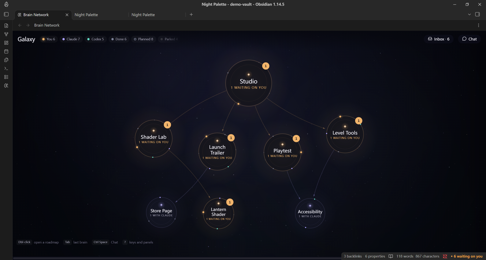
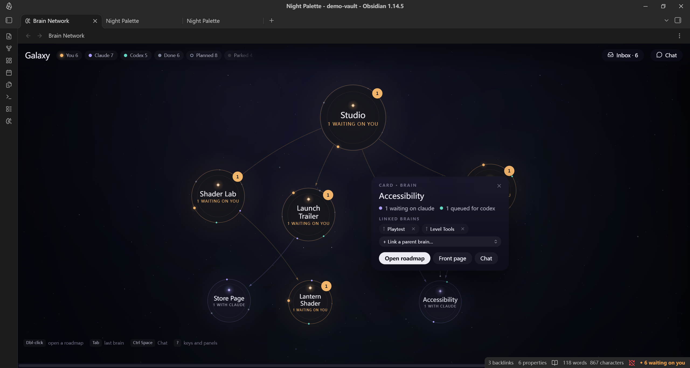
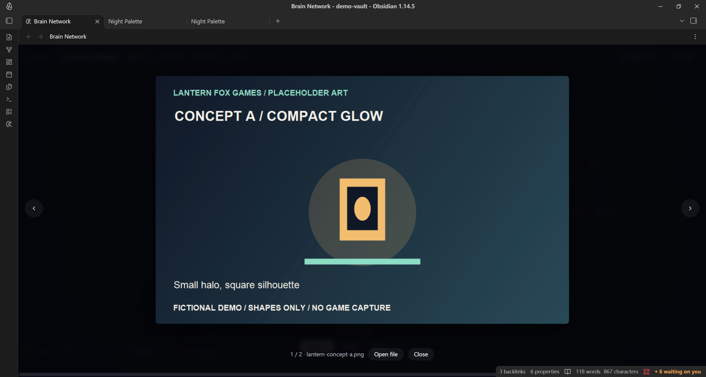

# Brain Network

**See what your AI agents are doing, and where they need you.**

Brain Network is an Obsidian plugin for people who work with AI agents inside their notes. One agent drafts, another verifies, a third gets launched by the second to build something, and somewhere in that chain a question waits for you. Brain Network draws all of it as one living map.

Each project is a brain. Its work items orbit it as moons. At a glance you can see:

- **who holds the ball** on every item: you, Claude or Codex;
- **how projects relate**: parent brains, child brains, and work in one project that waits on another;
- **which decisions wait on you**, with the images or clips that decide them, ready to review;
- **the trail behind each handoff**: the brief, the result, the check, and your reply, all in plain notes.

The map reads the same note properties the agents write. The picture is the work itself, so there is no second tracker to fall out of date.

## The collaboration it is built for

Agents do the legwork. You keep the judgment. Art, direction, money and anything sent to other people stay with you. Agents hand work to each other in the open, and every handoff leaves a dated result you can check. When an agent needs you, it prepares the decision: one line saying what to look at, and the evidence beside it.

## Trust is the point

A map like this is useful only while you believe it. Too many nodes and you stop reading it. Stale nodes teach you to ignore it. Nodes that make no sense make you doubt the rest. Research on automation calls the goal *appropriate reliance*: people rely on a tool as much as it deserves, and they can only judge that when the tool shows its state and its limits honestly. So Brain Network asks agents to keep the map lean and true:

- **A node earns its place.** Create one only for work someone must pick up, judge or wait on. Routine steps live inside the note.
- **One node per outcome.** It moves through its states across its life and is never duplicated.
- **Every node can be acted on.** It says who moves next, asks one clear question, and links to where the result lives.
- **Your attention is scarce.** Agents ask you only what only you can judge, and keep the number of open asks small.
- **Done means checked.** Results say what was verified and what was not.
- **Close the loop.** Finished work is marked done and paused work is parked, so nothing stale sits on the map.

## Notes drive the map

A brain is a folder with a front-page note containing `brain: <name>`. The front page uses `brain-parents` to link parent brains. A root brain can use `brain-parents: []`.

An item is a note in a brain folder with `brain-state`, or an entry in a note's `brain-plan` list. The closest containing brain folder owns the item. The demo has eight brains across three levels. Accessibility has both Playtest and Level Tools as parents.

| State | Meaning in the map |
| --- | --- |
| `owner` | Waiting on you |
| `claude` | Waiting on Claude |
| `codex` | Queued for Codex |
| `done` | Finished |
| `planned` | Planned |
| `parked` | Parked |

`brain-gate` marks an `art`, `decision`, `look`, or `approval` gate. `brain-ask` holds the question. `brain-review` lists review images or clips. The map shows review media beside the selected item. Click an image moon to open the lightbox. Review entries accept vault paths, paths relative to the note folder, wikilinks with or without extensions, Markdown links, and absolute file URLs.

`brain-stream` groups items into streams. `brain-after` links dependencies. Front pages can set stream order with `brain-streams`.

```yaml
brain-state: owner
brain-gate: art
brain-stream: Materials
brain-ask: "Choose the glow: concept A or concept B?"
brain-review:
  - "Assets/lantern-concept-a.png"
brain-after:
  - "[[Shader Lab/Palette Baseline]]"
```

Plan entries use `title`, `stream`, `state`, `gate`, `ask`, `link`, `review`, and `after` inside `brain-plan`. The demo includes examples.

Owner replies update the item's state, add a dated line under the note's `## Owner review`, and append to the plugin's `replies.jsonl`. `hooks/replies.cjs` hands pending replies to Claude Code on its next prompt when registered as a `UserPromptSubmit` hook. Copying the hook file does not register it.

The Chat can run Claude Code's CLI in the vault. **Start Codex** asks Claude to launch Codex using the brain's collaboration rules. The plugin also looks for recent local Codex session logs that name a queued brief. CLI login and agent setup are separate from installing the map.

## Install

1. Create `<vault>/.obsidian/plugins/brain-network/`.
2. Copy `main.js`, `styles.css`, `manifest.json`, and `hooks/replies.cjs` there, keeping the `hooks/` folder.
3. Reload Obsidian. Enable **Brain Network** under **Settings → Community plugins**.
4. Run **Brain Network: Open the map** from the command palette, or click the brain ribbon icon.

## Open the demo vault

In desktop Obsidian, choose **Open folder as vault** and select `demo-vault/`. Enable community plugins if prompted. Brain Network is already bundled and listed in the vault's enabled plugins.

Open `Studio Home.md`, then run **Brain Network: Open the map**. Double-click a brain to open its roadmap. Select **Lantern Glow**, **Route Readability**, or **Night Backdrop** to inspect sample gates and images. Open **Lantern Shader** for the Codex brief, result returned to Claude, and completed handoff trail.

The demo vault ships with **Settings → Brain Network → Send messages to Claude** turned off, so browsing and replying never start an agent. The plugin's own default is on, with Claude Code CLI permissions set to `bypassPermissions` (no permission checks). Review that setting before turning sending on in any vault.

The studio, people, work history, and art in this vault are fictional. The six PNGs are labelled placeholders. Validation and remaining checks are recorded in [DEMO_NOTES.md](DEMO_NOTES.md).

## Screenshots







[Watch the 60-second walkthrough](docs/brain-network-60s.mp4).

## License

[MIT](LICENSE). Copyright (c) 2026 PudinKiller.
